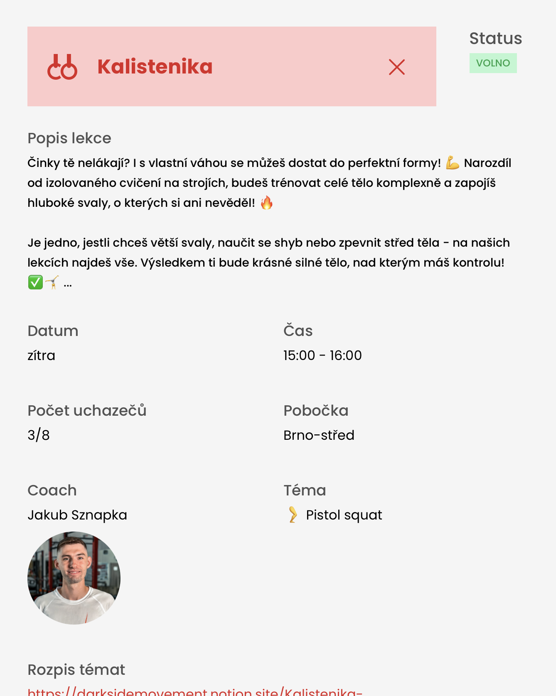

# dark-side-coach

Rozšíření doplňuje do detailu lekce v rezervacích Dark Side Movement jméno coache a téma z rozpisu v Notionu. Pokud je na stránce týmu k dispozici spárovaný portrét, zobrazí ho pod jménem.

[Stáhnout aktuální verzi](https://github.com/beny/dark-side-coach/releases/latest)

## Ukázka

## Chrome na počítači

1. Stáhni soubor `Dark Side Coach 0.1.7.zip` z části **Assets** a rozbal ho.
2. Otevři `chrome://extensions` a zapni **Režim pro vývojáře**.
3. Klikni na **Načíst rozbalené** a vyber složku se souborem `manifest.json`.
4. Obnov stránku rezervací a otevři detail lekce.

## Safari na Macu

1. V **Safari → Nastavení → Pokročilé** zapni **Zobrazit funkce pro webové vývojáře**.
2. V **Nastavení → Vývojář → Přidat dočasné rozšíření** vyber stažený ZIP.
3. Povol přístup k rezervacím a k rozpisu v Notionu, pokud se Safari zeptá. Pak obnov stránku rezervací.

Safari odebere dočasné rozšíření při ukončení nebo po 24 hodinách.

## Sestavení pro Safari

Projekt `safari/Dark Side Coach.xcodeproj` obsahuje aplikaci s rozšířením pro macOS a iOS. V Xcode vyber cílové zařízení a použij **Product → Run**. Pro instalaci na iPhone je potřeba aplikaci podepsat v Xcode. Na Macu se lokálně podepsané sestavení povoluje přes **Povolit nepodepsaná rozšíření**.

## Zdroj dat

Rozpis se vybírá z odkazu v detailu konkrétní lekce. Portréty se načítají z oficiální stránky týmu Dark Side Movement. [Náš tým](https://www.darksidemovement.cz/nas-tym)
